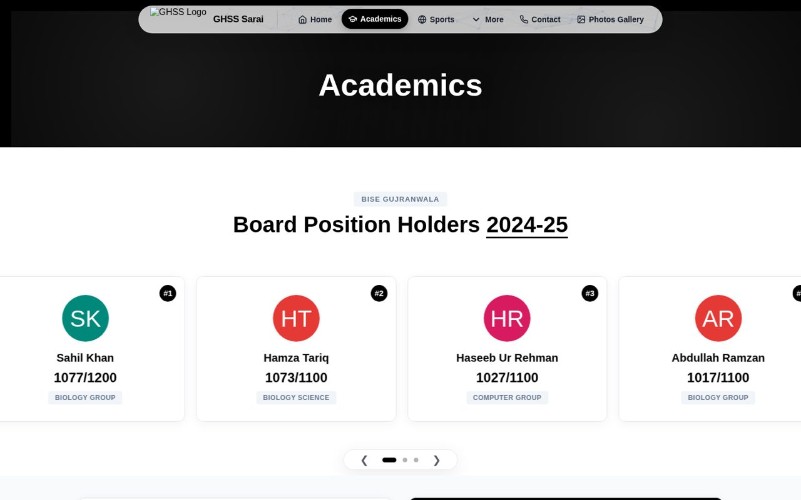

<div align="center">

# 🏫 Govt. Higher Secondary School, Sarai Alamgir — Official Website

### A fast, content-managed static site for a public school community

[](https://ghss-sarai.edu.pk/)
[](https://github.com/smuhammadbilalh/GMHSWebsite/actions)
[](#)
[](#)
[](#)

<a href="https://ghss-sarai.edu.pk/"></a>

</div>

---

## 📖 About

The official website of **Government Higher Secondary School, GT Road, Sarai Alamgir** (District Gujrat, Punjab). It gives students, parents and the community a single place for news, academics, faculty, sports, achievements, photo galleries and contact details — and lets school staff update all of it **without touching code**.

## ✨ Highlights

- 📰 **Live news ticker, hero slider & video carousel** on the home page
- 🎓 **Academics, Sports, Co-curricular, Medals of Honor, Faculty, Gallery & Contact** pages
- 🤝 **Donors section** to recognise community supporters
- ✍️ **Content management via Decap CMS** — every page is driven by JSON under `data/`, editable from the `/admin` panel with a simple form UI
- ⚡ **Zero-framework, zero-build** — plain HTML, CSS and vanilla JavaScript; loads fast on low-end phones and slow connections
- 🚀 **Automatic deployment** — every push to `master` is published to GitHub Pages by a GitHub Actions workflow
- 📱 **Fully responsive** with a mobile navigation drawer

## 🧱 How It's Built

```
GMHSWebsite/
├── index.html, academics.html, sports.html, ...   # One static page per section
├── css/                                           # Styles
├── js/                                            # One module per page (home.js, faculty.js, carousel.js, ...)
├── data/                                          # JSON content, one folder per page
│   ├── home/  (hero.json, news_ticker.json, donors.json, stats.json, video.json, ...)
│   ├── faculty/  academics/  sports/  medals/  photos/  contact/ ...
│   └── footer.json
├── admin/                                         # Decap CMS (config.yml + index.html)
├── images/                                        # Media uploaded through the CMS
└── .github/workflows/static.yml                   # Deploy to GitHub Pages
```

Each page's script fetches its JSON files and renders the DOM — so editors change content in the CMS, commit lands on `master`, Actions redeploys, and the site updates in about a minute.

## ⚡ Run Locally

No build step. Any static server works:

```bash
git clone https://github.com/smuhammadbilalh/GMHSWebsite.git
cd GMHSWebsite
python3 -m http.server 8080
# open http://localhost:8080
```

## ✏️ Editing Content

1. Visit `/admin` on the live site and sign in.
2. Pick a collection (Home Page, Faculty, Sports, …), edit the fields and **Publish**.
3. The CMS commits the JSON change and GitHub Pages redeploys automatically.

---

## 👨‍💻 Author

<div align="center">

**Muhammad Bilal** — IT Specialist & App Developer · Gujrat, Pakistan

[](https://github.com/smuhammadbilalh)
[](https://www.linkedin.com/in/muhammadbilaltech)
[](mailto:smuhammadbilalh@gmail.com)

⭐ If this project helped you, please consider giving it a star!

</div>
